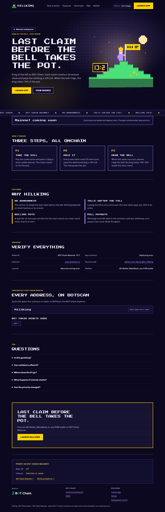

# Hillking

**Last claim before the bell takes the pot.** King of the Hill on BOT Chain. Each claim resets a 10-minute clock and pays the old king a 10% toll. When the bell rings, the king takes 70% of the pot.

**Officially launched on BOT Chain Mainnet** on 2026-11-03.

- Website and app: https://hillkingbot.vercel.app (app at [`/app/`](https://hillkingbot.vercel.app/app/))
- Network: BOT Chain mainnet, chain ID 677 · [BOT Chain](https://www.botchain.ai/) · [BOTScan](https://scan.botchain.ai/)



## How it works

1. **Take the hill.** Pay the crown price and plant a flag: a short public banner. The clock resets to 10 minutes.
2. **Hold it.** Every new claim costs 2% more and pays the dethroned king a 10% toll. The rest grows the pot.
3. **Hear the bell.** When the clock runs out, anyone rings the bell: the king takes 70%, 25% seeds the next round.

## Features

- **No randomness.** The winner is simply the last claim before the bell. Nothing depends on block hashes or an oracle.
- **Tolls soften the fall.** Losing the hill is not a total loss: the next claim pays you 10% of its price.
- **Rolling pots.** A quarter of every pot carries into the next round, so a new round never starts at zero.
- **Pull payouts.** Winnings and tolls wait in the contract until you withdraw, so a payout can never block the game.

## Contracts

| Contract | BOT Chain mainnet |
|---|---|
| `Hillking` | [`0x3b9abc82e267af598ab89697cfdd0ea59d5b6167`](https://scan.botchain.ai/address/0x3b9abc82e267af598ab89697cfdd0ea59d5b6167) |

BOT Chain infrastructure used: USDT `0xaBabc7Ddc03e501d190C676BF3d92ef0e6e87a3C`, WBOT `0xD5452816194a3784dBa983426cCe7c122F4abd30`, BDEX router `0x07032d47A1b9f8460cBeE9dC17c1d3E438693929`, BDEX QuoterV2 `0x034A705b36067cff99ABf5C662Be881cBd8d0176`.

Source: [`contracts/src`](contracts/src). Tests: [`contracts/test`](contracts/test). The contracts are unaudited; use small amounts.

## Develop

Requires Node 20+, [Foundry](https://getfoundry.sh) and Python 3.

```bash
git clone --recursive https://github.com/David-glitc/hillking.git
cd hillking
npm ci
npm test              # forge test
npm run build         # landing page + app into dist/hillking
npm run preview       # http://127.0.0.1:8771
```

`npm run build` writes `dist/hillking/index.html` (landing page), `dist/hillking/app/` (the dApp) and a Cloudflare Workers bundle under `sites/`.

### Wallets

The app discovers installed wallets with EIP-6963 (BO Wallet, MetaMask, OKX, Rabby and others) and falls back to `window.ethereum`. It switches or adds BOT Chain (chain ID `0x2a5`, RPC `https://rpc.botchain.ai`) before any transaction, and simulates every call before asking for a signature.

### Rehearse on a mainnet fork

```bash
anvil --fork-url https://rpc.botchain.ai --port 8677 --chain-id 677
export BOT_RPC_URL=http://127.0.0.1:8677
node scripts/deploy.mjs && node scripts/fork-check.mjs
```

### Deploy

`scripts/deploy.mjs` reads the deployer key from `BOT_SIGNER_FILE` (default `~/.config/botchain-wave1/deployer.env`, never committed), refuses to broadcast on mainnet without `BOT_MAX_GAS_BOT`, and journals every transaction to `deployments/mainnet.json` so it can resume. `npm run publish` deploys the built site to Vercel as a static production deployment.

## License

MIT. Built on [BOT Chain](https://www.botchain.ai/).
